<div align="center">


# 红果短剧解析与下载工具 · hongguo-downloader

**红果短剧解析 · 全集下载 · 批量下载 · 整剧打包** —— 粘贴一条分享链接，云端解析全部集数后处理，按集付费取件。
把「手动逐集存片」变成「一条链接」的解析与下载交付系统，**在线版、免安装**，打开网页即可使用。

Hongguo **short drama downloader**: paste one share link, and every episode is delivered from the cloud
with per-episode pricing. No install and no app login — it runs in a browser, on phone or desktop.

<p>
  <a href="https://hongguoapi.com?utm_source=github&utm_medium=readme&utm_campaign=hongguo-downloader">
    
  </a>
  &nbsp;
  <a href="#架构">
    
  </a>
</p>

<p>
  
  
  
  
</p>

<sub>非官方项目，与红果 / 字节跳动无任何关联。</sub>

</div>

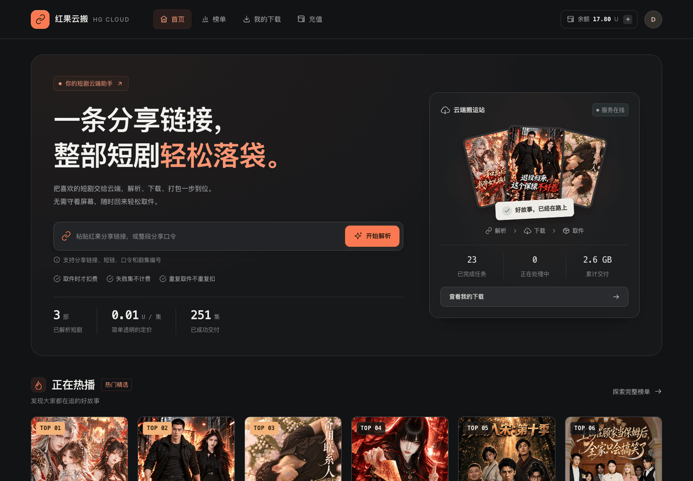

---

## 这是什么

红果短剧只提供「在 App 里一集一集看」，没有全集下载，也没有批量导出。想留存一套完整剧集，要么手动点几百次，要么装个客户端硬啃。

这个项目把整条链路做成了一个网页服务：**你只负责贴链接，下载、解密、校验、打包、发直链全部在云端完成，最后按实际下载的集数计费。**

| 传统做法 | 本系统 |
|---|---|
| 逐集点击、逐集等加载，1000 集要几小时 | 贴一条链接，云端并发处理，交付以分钟计 |
| 断在中间得从头再来 | 每集独立状态，失败自动重排，已完成的跳过 |
| 本地存一堆文件，找起来靠记忆 | 统一任务列表 + 24 小时有效直链，随时回来取 |
| 先付钱、不知道能不能下成 | **取件时才扣费**，失败不收费，重复取件不重复扣 |

**和桌面客户端的区别**：**免安装**、不用配环境、不用自己合并转码 —— 打开网页就能用，手机同样可以操作。下载完成既可按**分集直链**逐集取，也可一次**整剧打包**。

**其他常见叫法**：hongguo downloader、hongguo 短剧下载器、红果免费短剧下载工具、红果短剧批量导出、hongguo duanju downloader；
海外两条线分别是 [pine drama downloader / PineDrama](docs/pinedrama.md) 与 [reelshort downloader / ReelShort 短剧下载](docs/reelshort.md)
—— 指的都是这一个项目。

---

## 三步完成一次交付

| ① 贴链接 | ② 云端处理 | ③ 取件计费 |
|---|---|---|
| 粘贴红果分享链接、整段分享口令，或直接填剧集编号。解析后立刻看到剧名、封面、集数与更新进度。 | 关掉网页也没关系。任务在服务端排队执行，每集独立重试，进度实时可见，完成后站内提醒。 | 勾选需要的集数，确认后一次性扣费并生成 24 小时直链，可单集取、也可打整包 ZIP。 |

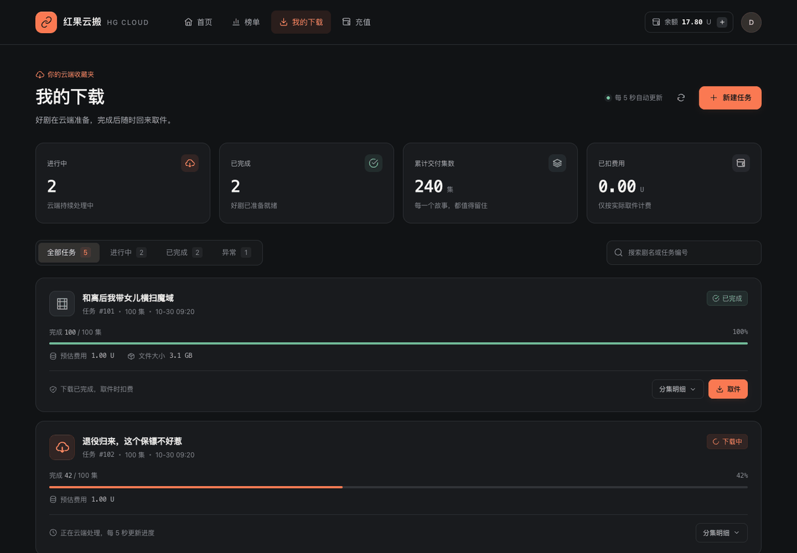

---

## 功能一览

| 模块 | 能力 |
|---|---|
| 解析 | 分享链接 / 分享口令 / 剧集编号三种输入；24 小时缓存，重复解析不重复请求上游 |
| 发现 | 热播榜、真人榜、AI 榜、动漫榜四类榜单（6 小时刷新）；按剧名搜索，60 秒缓存 |
| 海外 · PineDrama | 海外剧场：榜单 + 14 个题材分类 + 中英文剧名搜索；英文原声直连 tiktokcdn，支持整包 ZIP 与简中 / 英文 / 西语字幕现翻 · [专页](docs/pinedrama.md) |
| 海外 · ReelShort | 欧美向英文短剧（werewolf / revenge / billionaire 题材）：214 个题材标签 + 13 个榜单楼层 + 剧名搜索；HLS 直连封装 mp4，1080P 原画，支持整包 ZIP · [专页](docs/reelshort.md) |
| 任务 | 同剧同集自动复用运行中的任务，不重复扣费；失败集单独重试，可随时取消 |
| 交付 | 分集直链 / 按需整剧打包 ZIP；直链默认以「附件」下发，点开即下载而不是在线播放；支持断点续传 |
| 计费 | 余额 + 卡密 + 在线支付三通道；**扣费发生在取件**，`job_id` 唯一键保证并发取件只扣一次 |
| 支付 | Binance Pay（USDT，唯一金额指纹 + 备注码）与 Stripe（卡 / Apple Pay，托管收银台）双通道，官方查单为准 |
| 后台 | 总览、用户、订单、卡密、下载任务五个页面；CSV 导出；卡密生成与作废（唯一的不可逆写操作） |
| 运维 | 健康检查暴露 db / oss / device / queue 状态；任务心跳超时自动回收 |

---

## 界面

### 用户端

<table>
<tr>
<td width="50%">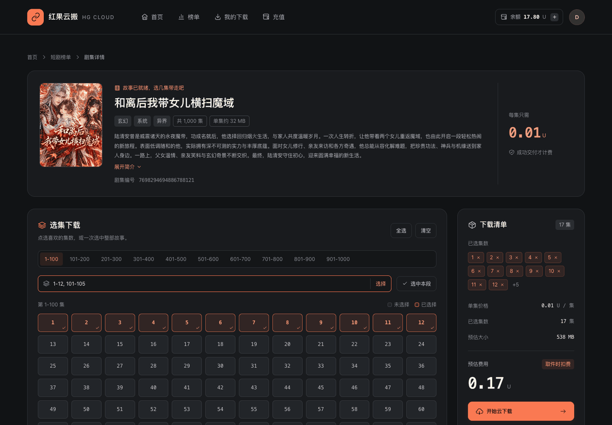</td>
<td width="50%">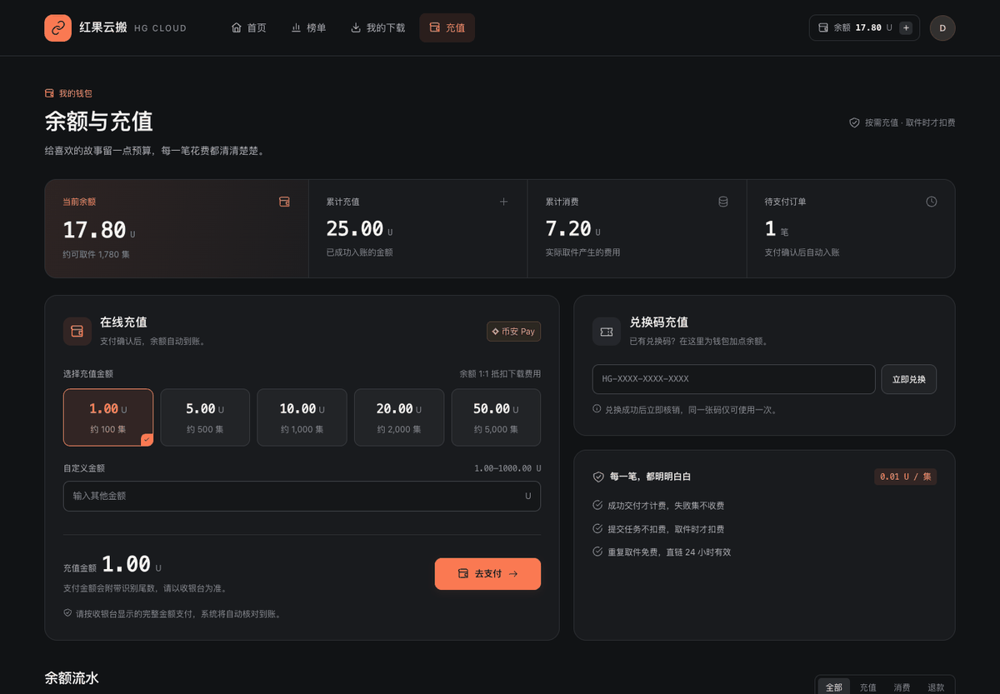</td>
</tr>
<tr>
<td align="center"><sub>剧集详情 · 选集、看单集均值体积、按集计费</sub></td>
<td align="center"><sub>余额与充值 · 卡密 / 在线支付双入口，流水逐笔可对</sub></td>
</tr>
<tr>
<td width="50%">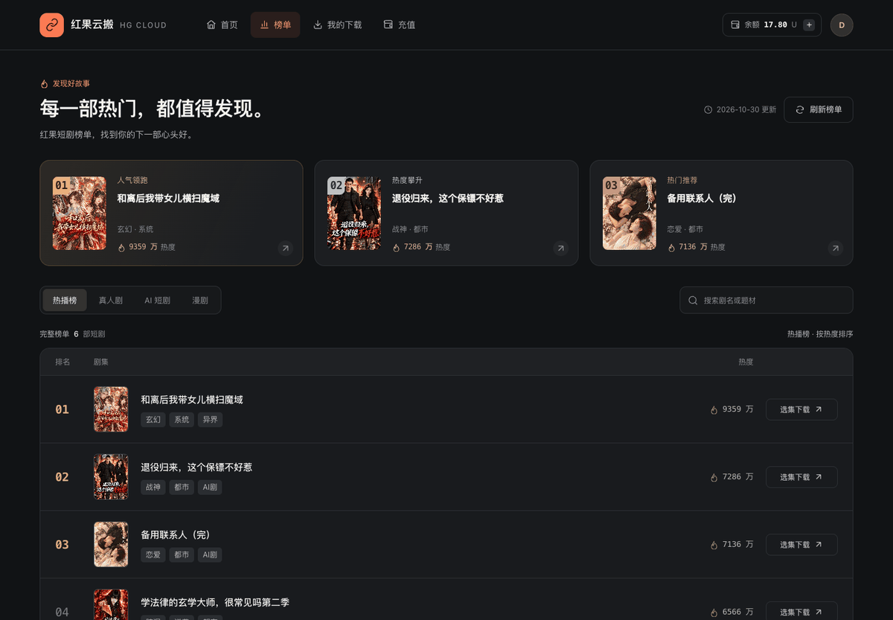</td>
<td width="50%"></td>
</tr>
<tr>
<td align="center"><sub>榜单 · 四类榜单 6 小时刷新</sub></td>
<td align="center"><sub>任务 · 逐集状态色块，失败集可单独重试</sub></td>
</tr>
</table>

<p align="center">
  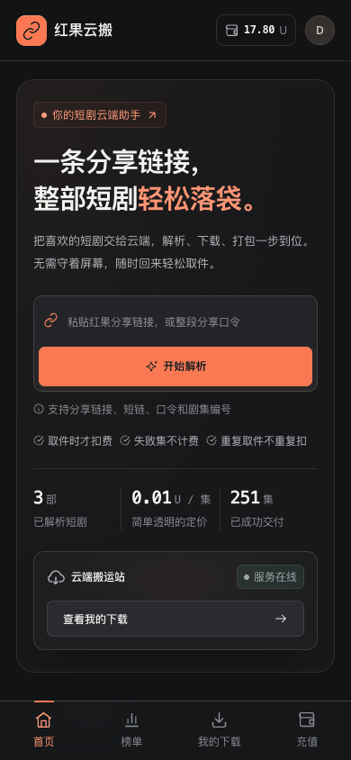
  &nbsp;&nbsp;&nbsp;
  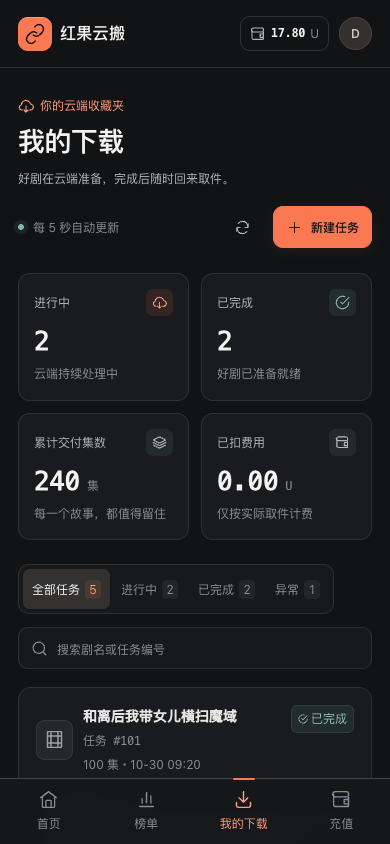
  <br />
  <sub>移动端：390px 宽度下完整可用</sub>
</p>

### 运营后台

<table>
<tr>
<td width="50%">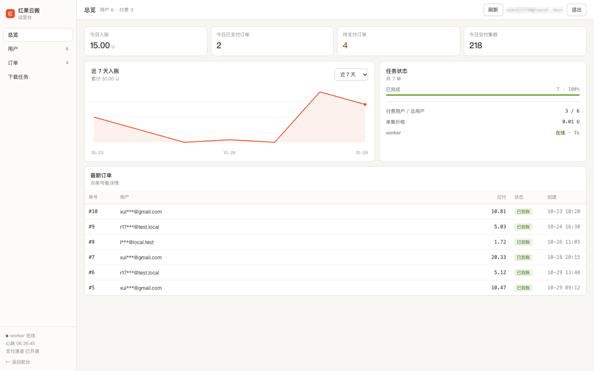</td>
<td width="50%">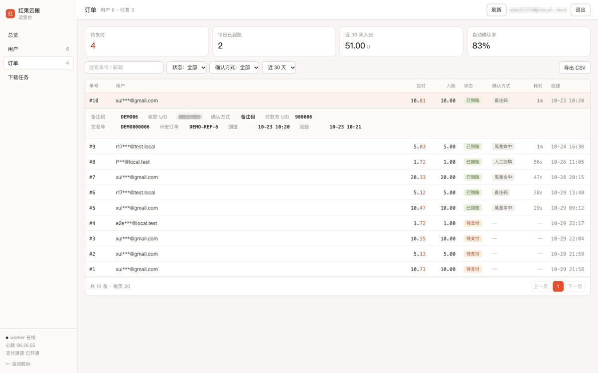</td>
</tr>
<tr>
<td align="center"><sub>总览 · 按东八区切日，底部直接给 worker 存活与支付通道状态</sub></td>
<td align="center"><sub>订单 · 应付尾数高亮，确认方式区分自动 / 人工</sub></td>
</tr>
</table>

<p align="center">
  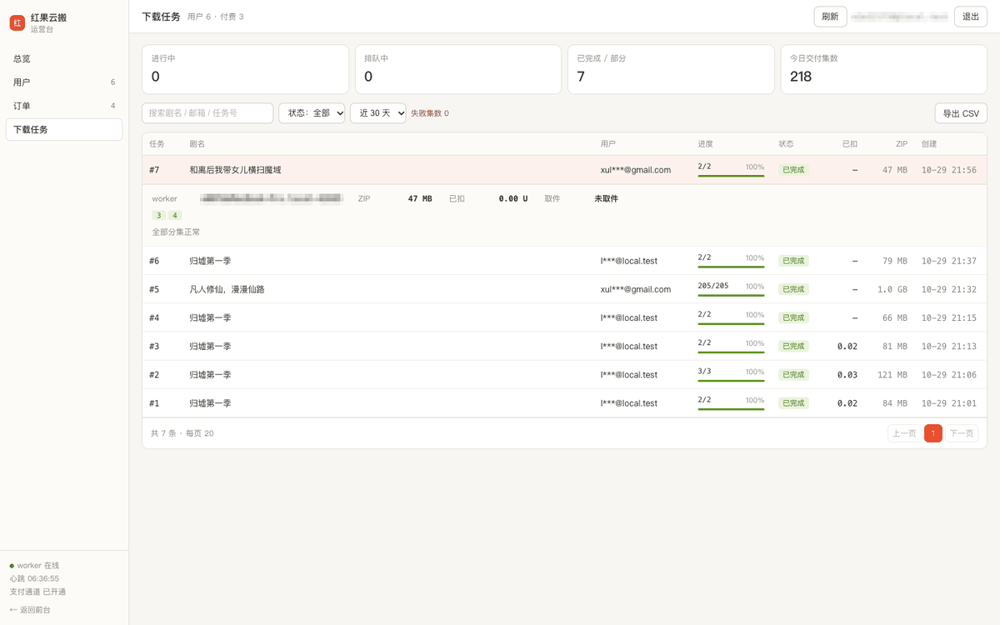
  <br />
  <sub>任务监控 · 逐集色块 + 失败原因 + worker 归属，卡单一眼可见</sub>
</p>

> 截图中的邮箱、UID、主机名均已脱敏；界面内剧集海报版权归原权利方，仅作界面示意。

---

## 案例演示

### 案例一 · 1000 集长剧，85 秒完成交付

一次 1000 集的整剧任务，worker **只上传分集文件**（`ep-001.mp4` … `ep-1000.mp4`），不在下载阶段同步打整包：

- 单集约 13.9 MB，走 OSS 内网 endpoint，不产生公网流量费；
- 下载阶段耗时约 85 秒，任务状态即变为「已完成」，用户可立即取件；
- 需要整包时才由打包服务按需生成 `all.zip`（函数计算或本地流式直传），**不占用 worker**，也不阻塞后续任务；
- 打包前逐集核对文件，库里标记成功但文件缺失的集会回退为失败 —— 宁可报错，绝不打出残缺包。

结果是：**下载与打包解耦**，长剧不必等到最后一份字节落盘才能开始取件。

### 案例二 · 双支付通道，对账不靠人盯

```
币安 Pay：下单 → 唯一金额 1.72 + 备注码 N5GSTY → 用户转账
          → 收银台每 3 秒查单，服务端顺带拉官方流水
          → 唯一金额命中 / 备注码命中 / 用户回填订单号，三选一即入账

Stripe： 下单 → 建 Checkout session（metadata 带 order_id）→ 跳转付款
          → webhook 只做唤醒，入账仍以官方 retrieve 为准
```

两个关键口径：

1. **入账 = 实付**。币安流水实际到账多少就入账多少，识别尾差不是手续费，绝不按面额截留；
2. **回调不盲信**。webhook 只用来提速，验签通过后仍以官方查单结果落账；未配置签名密钥时直接 503，不降级成「盲信模式」。

后台「自动确认率」就是这条链路的体检指标：正常 80%+，一掉就说明对账在退化，需要人工介入。

### 案例三 · 实例被摘除，75 秒自愈

生产是单机自愈架构（伸缩组 MIN=MAX=1 + 自定义镜像 + Cloudflare Tunnel，源站不开放任何公网端口）。故障演练实测时间线：

| 时刻 | 事件 |
|---|---|
| T+0s | 手动摘除实例，站点立即 530 |
| T+60s | 伸缩组用镜像拉起新节点，UserData 注入配置 |
| T+68s | 设备层冷启动与附着自检通过 |
| T+75s | `GET /health` 恢复 200，隧道自动重连 |

没有人工介入，也没有「重启一下就好了」这种不可复现的操作 —— 因为修复动作全部写在 UserData 里，而不是留在某台机器的 shell 历史里。

---

## 架构

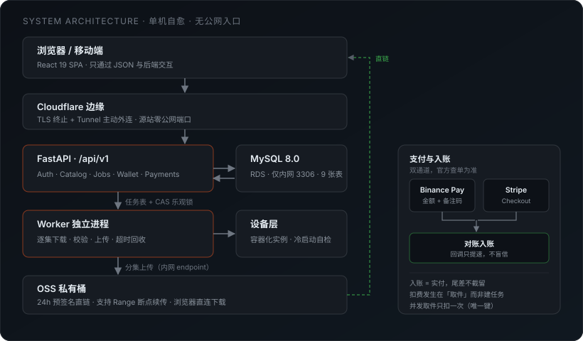

四个刻意的取舍：

1. **队列用表，不引 Redis**。任务表 + CAS 乐观锁 + 心跳超时回收，少一个中间件就少一类故障；
2. **扣费在取件，不在建任务**。用户先看到「能下成」再付钱，`download_links.job_id` 唯一键兜住并发重复扣费；
3. **重活全在 worker**。API 只读写数据库、发任务，下载与转码在独立进程，被杀掉重启会跳过已完成的集；
4. **直链签发分离**。存储层只做预签名，链接有效期 24 小时，过期重取不重复扣费。

---

## 技术栈

| 层 | 选型 |
|---|---|
| 前端 | React 19 · Vite 7 · TypeScript · TanStack Query · 自建设计令牌（深色前台 / 浅色后台） |
| 后端 | FastAPI · SQLAlchemy · Pydantic · 纯 JSON API（`/api/v1/*`） |
| 数据 | 开发 SQLite / 生产 MySQL 8.0（RDS，仅内网） |
| 存储 | 阿里云 OSS 私有桶 + 预签名直链（支持 Range），可降级本地磁盘 |
| 任务 | 独立 worker 进程 + 表级队列 + CAS 乐观锁 + 心跳回收 |
| 支付 | Binance Pay（只读 API 拉流水对账）· Stripe Checkout + Webhook |
| 部署 | 自定义镜像 + 伸缩组自愈 + Cloudflare Tunnel（无公网入口） |
| 质量 | 96 项接口冒烟 + 52 项 Playwright 真实浏览器 e2e（不 mock 接口、不注入登录态） |

---

## 项目状态

| 项 | 值 |
|---|---|
| 主线版本 | v0.16.0 |
| 线上地址 | <https://hongguoapi.com> |
| 接口文档 | <https://hongguoapi.com/api/docs> |
| 健康检查 | <https://hongguoapi.com/health> |
| 双通道支付 | Binance Pay + Stripe，均已端到端验证 |

本仓库与大版本同步更新：每次正式发版后，README 与截图会跟着刷新。若你看到的状态与线上不符，欢迎开 issue 指出。

---

## 常见问题 · FAQ

<details>
<summary><b>红果短剧怎么下载到本地？</b></summary>

<br />

三步：复制红果 App 里的分享链接（或整段分享口令）→ 粘贴到在线版 → 解析后勾选要的集数取件。
下载、校验、打包都在云端完成，下完拿到的是**分集直链或整剧 ZIP**，可以直接存到手机、电脑或网盘，不必守着 App 一集一集点。

</details>

<details>
<summary><b>红果短剧下载要花钱吗？</b></summary>

<br />

解析、看榜单、浏览剧集信息都是免费的；<b>只有取件时才按实际集数计费</b>，下载失败的集不收费。
本项目不提供会员制，也不卖「无限下载」——成本与集数线性相关，按集计费对双方都更清楚。

</details>

<details>
<summary><b>支持红果免费短剧的全集下载吗？</b></summary>

<br />

支持。粘贴任意一集或整部剧的分享链接，解析后可以一次勾选全部集数；取件时既可单集直链下载，也可一次生成 ZIP 整包，两种方式都支持断点续传。

</details>

<details>
<summary><b>为什么按集计费，而不是会员制？</b></summary>

<br />

因为成本与集数线性相关（带宽、存储、设备占用），会员制会让「下 1000 集」和「下 10 集」的人付一样的钱，最后只能靠限速来平衡。按集计费更接近真实成本，用户也更容易算清一次要花多少。

</details>

<details>
<summary><b>重复取件会不会重复扣费？</b></summary>

<br />

不会。扣费绑定在「取件记录」上，`job_id` 唯一键保证同一任务只生成一条扣费记录；重复点取件只会刷新直链有效期。

</details>

<details>
<summary><b>下载失败会扣钱吗？</b></summary>

<br />

不会。失败的集不计费；已经扣费但交付失败的，走退款流水回补余额。

</details>

<details>
<summary><b>Is there a Hongguo downloader for PC or Mac?</b></summary>

<br />

Yes — it is browser-based, so the same site works on Windows, macOS, Linux, Android and iOS.
Nothing to install: you paste the share link, the cloud workers fetch and verify every episode,
and you get either per-episode direct links or one ZIP for the whole drama.

</details>

<details>
<summary><b>What is hongguo downloader?</b></summary>

<br />

`hongguo-downloader` is the open-source showcase of a cloud pipeline for Hongguo (红果) short dramas —
the cdrama / duanju format where each drama is split into hundreds of 1–2 minute episodes.
The pipeline resolves a share link, downloads every episode server-side, verifies each file,
and delivers signed links priced per episode. This repository documents the design and architecture;
no downloader binary or bypass tool is distributed here.

</details>

<details>
<summary><b>PineDrama 的剧能下载吗？</b></summary>

<br />

能，站内「海外剧场」栏目就是 PineDrama：<https://hongguoapi.com/global>。
按榜单或 14 个题材分类浏览，也可以直接搜剧名（中英文都行），打开剧集勾选集数即可。
英文原声经 tiktokcdn 直连落盘，不需要模拟器、也不用装 App；支持按集取与整包 ZIP，
字幕可现翻简中 / 英文 / 西语。海外剧与国内剧共用同一份余额和任务队列。
能下什么、字幕怎么导出、有哪些限制，见 [PineDrama 专页](docs/pinedrama.md)。

</details>

<details>
<summary><b>ReelShort 的剧能下载吗？</b></summary>

<br />

能，站内 [ReelShort 栏目](https://hongguoapi.com/reelshort) 就是它：按 New Release / TOP 等 13 个榜单楼层浏览，
或用 214 个题材标签筛，也可以直接搜英文剧名（werewolf、billionaire 这类）。
打开剧集勾选集数即可，云端按 HLS 拉流并封装成 mp4，完成后按集取直链或整包 ZIP。
1080P 原画、**没有字幕**（上游不给），单集均值约 39 MB；与红果、PineDrama 共用同一份余额和任务队列，
按集计费每集 0.01 U，取件才扣费。能下什么、有哪些限制，见 [ReelShort 专页](docs/reelshort.md)。

</details>

<details>
<summary><b>Can I download ReelShort dramas?</b></summary>

<br />

Yes — ReelShort (the English vertical short-drama app, werewolf / revenge / billionaire titles) is wired into the
same pipeline at <https://hongguoapi.com/reelshort>: browse 13 ranking floors or 214 genre tags, search an English title,
pick episodes, and the cloud pulls each HLS segment and muxes it into a 1080p mp4. You then download per-episode
links or one ZIP for the whole drama. Pricing is per episode (0.01 U each), charged only when you take delivery.
ReelShort titles carry no subtitles upstream. Details: [ReelShort page](docs/reelshort.md).

</details>

---

## 免责与权利声明

- 本项目为**非官方**第三方工具，与红果、字节跳动及其关联公司无任何关系，未获其授权、认可或赞助。
- 本仓库仅用于展示产品设计、系统架构与工程实践，**不提供**任何内容获取工具、破解方法或可执行代码。
- 界面截图中出现的剧集名称、海报、人物形象，其著作权归原权利方所有，仅作界面示意，不构成对任何作品的授权或推荐。
- 使用者应自行确保对下载内容拥有合法权利，并遵守所在地法律法规与平台服务条款。作者不对任何滥用行为承担责任。
- 文档与截图采用 [CC BY-NC 4.0](LICENSE) 许可：可转载署名、不可商用。

---

<div align="center">
<sub>

**[在线体验 →](https://hongguoapi.com?utm_source=github&utm_medium=readme&utm_campaign=hongguo-downloader&utm_content=footer)** · 有问题请开 issue，只接受文档纠错

</sub>
</div>
